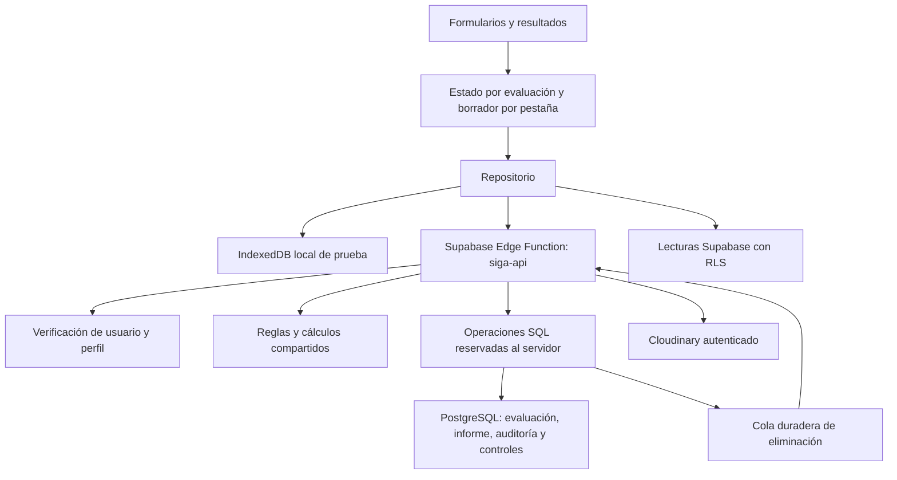

# Arquitectura v2

La interfaz conserva HTML y CSS y se compila con Vite. Cada página tiene un controlador pequeño; los módulos no escriben directamente en la base.

## Límites de responsabilidad

| Capa                                | Responsabilidad                                                                             |
| ----------------------------------- | ------------------------------------------------------------------------------------------- |
| `supabase/functions/_shared/domain` | Validación, cálculo puro y versiones. No usa interfaz, cuentas ni red.                      |
| `js/pages`                          | Capturar controles y representar resultados mediante nodos y texto.                         |
| `js/store.js`                       | ID fijo, borrador por usuario/pestaña, orden de escrituras y recuperación.                  |
| `js/repository.js`                  | Contrato de persistencia; implementación local o Supabase.                                  |
| `siga-api`                          | Verificar sesión, autorizar, recalcular, validar archivos y coordinar operaciones externas. |
| Migraciones SQL                     | RLS, permisos, bloqueo de filas, revisión, inmutabilidad y auditoría.                       |

Las reglas se importan desde el mismo código en ambos entornos. El servidor descarta puntajes enviados por el navegador y los vuelve a calcular. Las operaciones SQL solo aceptan llamadas del rol de servicio; ninguna clave de servicio se compila en el navegador. `verify_jwt=false` en la función permite una credencial de mantenimiento independiente: cada solicitud de usuario se verifica expresamente con `auth.getUser()`.

## Persistencia y concurrencia

Cada evaluación viaja en su URL. La pestaña conserva el ID al abrirla; no lee un ID activo global al guardar. Los borradores usan `sessionStorage` con usuario e ID. Los cambios de controles se capturan inmediatamente, se conservan como borrador y se guardan automáticamente tras una pausa. La navegación espera el guardado.

Las escrituras incluyen la revisión esperada. PostgreSQL bloquea la evaluación y rechaza revisiones antiguas; el navegador conserva el borrador y permite exportarlo, reintentar o recargar. Nunca resuelve un conflicto sustituyendo silenciosamente la versión del servidor. Las cargas también bloquean el padre para aplicar cupos frente a concurrencia. El repositorio local reproduce estas garantías mediante transacciones IndexedDB y una revisión adicional de evidencias.

Cerrar exige identificación, ambos métodos, 30 respuestas, preparación, seis revisiones de calidad, foto, video, vínculo de evidencias y un plan de acción cuando corresponde. Se conserva un expediente inmutable con datos, evidencias, versiones, revisión, actor, fecha y huella. El visor comprueba tanto la huella del contenido como su correspondencia con los datos que representa. El seguimiento posterior se guarda en otra tabla y genera auditoría.

SHA-256 detecta cambios del expediente; no constituye firma digital, sello de tiempo externo ni protección frente al propietario de la infraestructura. PostgreSQL y el equipo con acceso al rol de servicio forman parte de la confianza del sistema.

## Archivos y fallos entre servicios

1. Validar sesión, propietario, metadatos, cabecera del archivo y tamaño.
2. Reservar en PostgreSQL una evidencia pendiente con UUID, huella y cupo.
3. Enviar el archivo firmado al proveedor con tipo `authenticated`.
4. Activar el registro solo cuando Cloudinary confirma ID, recurso y tipo.
5. Ante un fallo, conservar un trabajo de eliminación. El mantenimiento recupera reservas pendientes de más de diez minutos y ejecuta reintentos con espera creciente.

Las entregas usan enlaces firmados que caducan a los cinco minutos. El navegador los solicita solo al abrir una evidencia o preparar impresión. Los límites son 10 MB por imagen, 25 MB por video, 10 fotos y 3 videos por evaluación. Se admiten JPG/PNG/WebP y MP4/MOV/WebM; comprobar cabeceras no sustituye un antivirus. El borrado termina después de la confirmación del proveedor; no se borra primero la fila para aparentar éxito.

El mantenimiento requiere un programador externo cada cinco minutos y una alerta por trabajos atrasados. Esa infraestructura no queda creada por compilar la web. Véase DESPLIEGUE.md.

## Decisiones y límites

- Se conserva una aplicación modular sin incorporar un framework de interfaz: el tamaño actual no requiere uno.
- El modo demo es una herramienta para pruebas ficticias; IndexedDB puede ser borrado por el navegador y no ofrece control real de acceso.
- La sesión real se gestiona con Supabase; RLS controla lecturas y la función controla escrituras. El cierre de sesión elimina borradores del usuario. La configuración de expiración, CAPTCHA y contraseña filtrada pertenece al proveedor y debe aplicarse allí.
- La referencia de REBA es el material Cornell 2001; RULA usa la tabla del artículo original de 1993, incluidas las discrepancias documentadas frente a algunas hojas secundarias. Las versiones se conservan en cada informe.
- El cuestionario propio ofrece índices orientativos; no demuestra conformidad normativa. La observación, selección de postura y interpretación deben revisarse con el profesional responsable antes de uso operativo.
- La migración conserva un evento `importacion_v1` con el registro antiguo y exige revisar expedientes anteriores. No inventa una auditoría histórica que nunca existió.
- No se añade borrado de evaluaciones cerradas desde la interfaz. La política de conservación y las solicitudes de eliminación requieren un procedimiento administrativo definido.
